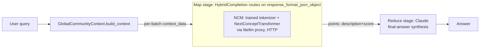
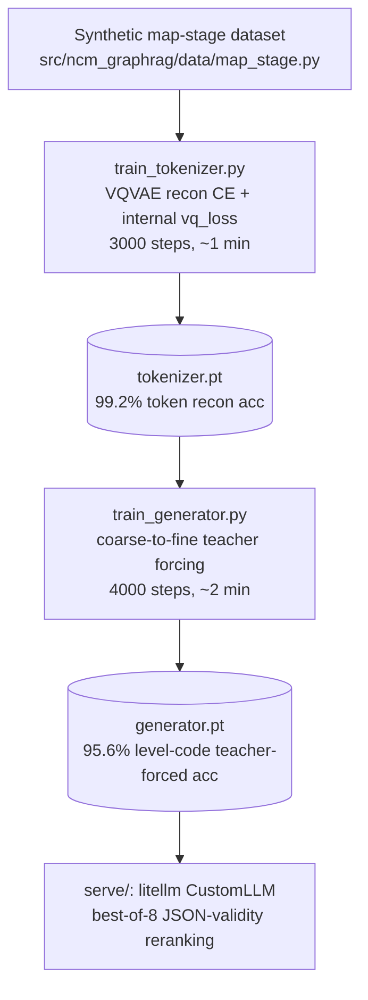
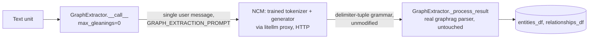
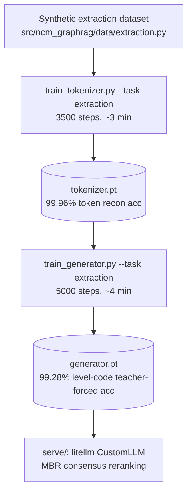

# Architecture

## Integration seam (graphrag side)

graphrag's LLM layer is `graphrag-llm` (`third_party/graphrag/packages/graphrag-llm`):
an abstract `LLMCompletion` (`completion/completion.py`) with a sync `completion()`
and async `completion_async()`, created generically through
`graphrag_llm.completion.create_completion(ModelConfig)`. The default/only built-in
implementation, `LiteLLMCompletion`, routes every call through LiteLLM
(`litellm.acompletion(model=f"{provider}/{model}", api_base=..., ...)`).

**This makes pointing graphrag at an OpenAI-compatible local server a pure config
change** — no graphrag code edits needed:

```python
ModelConfig(
    type="litellm",
    model_provider="openai",
    model="ncm-mapstage",
    api_base="http://127.0.0.1:4010/v1",
    api_key="sk-ncm-local",
)
```

Three bounded-output call sites all go through the identical
`completion_async(messages=..., response_format_json_object=...)` seam:
- `graphrag/index/operations/extract_graph/graph_extractor.py` (entity/relationship
  extraction) — free-text delimiter format, multi-round "gleaning" loop for the full
  task. **This project's second slice**, scoped to the single-shot, entity-only part
  of the call (`max_gleanings=0`, no relationship extraction) — see below.
- `graphrag/query/structured_search/global_search/search.py:_map_response_single_batch`
  (Global Search map stage) — single-shot, `response_format_json_object=True`,
  `{"points":[{"description","score"}, ...]}`. **This project's first slice.**
- `graphrag/index/operations/summarize_communities/community_reports_extractor.py`
  (community reports) — single-shot, typed `response_format=CommunityReportResponse`
  pydantic schema. Natural third slice (not implemented here).

## Slice 1: Global Search map stage



- **Map stage → NCM.** Bounded JSON output
  (`{"points":[{"description":...,"score":...}]}`), single report in, single point out.
- **Reduce stage → standard AR LLM (Claude via litellm).** Open-ended multi-paragraph
  synthesis across all map responses, per the task brief's own recommendation.
- `HybridCompletion` (`src/ncm_graphrag/graphrag_integration/hybrid_completion.py`)
  implements `LLMCompletion` and routes between two real `create_completion(...)`
  instances on the one signal that distinguishes the two call shapes:
  `response_format_json_object` is set for the map call, never for reduce
  (`search.py:97` + `:240` vs `:396-404`). `GlobalSearch` itself has no native
  two-model split — this wrapper is what makes the hybrid split possible without
  touching graphrag code.

## Slice 1 training pipeline (fills the gap: no official NCM trainer exists)

`train_generator.py` precomputes frozen VQ-VAE codes and next-level embeddings
in `<generator save_path>.cache.pt`. `NCM_GENERATOR_CACHE` overrides that path.
The cache records SHA-256 identities for the tokenizer checkpoint bytes, loaded
model state, and both complete tokenized prefix/target matrices (including dtype,
shape, row order, padding, and EOS). Model architecture, quantizer levels, and a
format version are also checked. Checkpoint weights must match the loaded model.
Stored tensor checksums detect changed payloads.

Changed checkpoints or tokenized data and legacy caches without provenance produce
an error naming the cache. Remove that file and rerun training to rebuild; never
reuse a pre-provenance cache. New files are written atomically. Cache construction
uses eval mode, batches of 64, and CPU storage; training transfers only selected
rows to the model device. Prefix embeddings remain computed online, preserving
condition dropout and contextual-prefix behavior.

The offline CPU acceptance workload (`scripts/autoresearch_cache_benchmark.py`)
compares cached codes and embeddings with fresh VQ-VAE outputs and runs a generator
optimizer step. Run it with `CUDA_VISIBLE_DEVICES=""` and
`PYTHONPATH=third_party/ncm:src` using the project's uv environment.
Regression coverage independently changes prefix and target token IDs, replaces a
checkpoint at the same path, and rejects legacy or altered cache payloads.

`bash autoresearch.sh` now runs `scripts/autoresearch_fewnerd_quality.py` locally,
offline and CPU-only, with CUDA hidden and one Torch thread. It never trains,
downloads, or schedules a GPU job. Primary `tokenizer_entity_f1` is mean
per-example typed entity-set reconstruction F1 in percentage points, using greedy
token decoding. Its initial model is an explicitly labeled seed-0 **untrained
control**, not either unverified local checkpoint or the historical probe.

`benchmarks/fewnerd/frozen.json` pins the copied GPT-2 assets and stored row/token
manifests. Raw input identity is SHA-256 over NFC/collapsed-whitespace text,
preserving case and excluding labels. Conflicting raw annotations are quarantined
globally before eligibility filtering; tuning excludes every raw official-train
identity. The available clean generator pool is 49,026 groups (all retained),
with its first 6,000 seed-0 selected rows used by the tokenizer, and 1,000
seed-42 tuning groups. These are sentence-disjoint, not document-disjoint.
The raw audit found 2,384 globally conflicting groups. Reserved-test selection
and predictions remain deferred pending historical-use clearance.

The executable scorer oracle must reach 100% F1, entity-set exactness, and strict
grammar validity. The train-only grounded dictionary freezes Unicode/boundary,
longest-span-first, candidate-type, and tie rules in
`src/ncm_graphrag/data/fewnerd_quality_metrics.py`; initial tuning F1 is 36.35%.
The report at `artifacts/fewnerd-quality-harness/report.json` records raw
reconstructions, literal GPT-2 name-token alignment/exposure, seen/unseen and
one/two-entity diagnostics, separate CE/VQ losses, EOS behavior, utilization,
and both historical and strict validity. A first-32-row training diagnostic
does **not** replace the proposal's trained tiny-set overfit control.

With no `benchmarks/fewnerd/candidate.pt`, evaluation reconstructs the untrained
seed-0 control. A candidate requires `candidate.provenance.json` with
`kind: controlled_tokenizer`, positive `completed_steps`, `initialization_seed`,
`checkpoint_sha256`, `training_manifest_sha256` matching `tokenizer-train.jsonl`,
and the resolved `vqvae_config`. Missing/mismatched provenance, changed frozen
inputs, leakage, architecture changes, or non-finite outputs fail closed.
Training and the proposal's continuation gates have not been exercised.
Inputs can be recreated offline with
`PYTHONPATH=third_party/ncm:src uv run --offline --frozen python
scripts/prepare_fewnerd_quality_inputs.py --corpus-root /path/to/corpora
--output /path/to/new/frozen-directory`; it refuses to overwrite a nonempty
directory. Input source hashes describe preparation; report source hashes identify
the code actually evaluated.

The ordinary tokenizer trainer also exposes a separate, explicit tiny-set control:

```bash
CUDA_VISIBLE_DEVICES="" OMP_NUM_THREADS=1 HF_HUB_OFFLINE=1 TRANSFORMERS_OFFLINE=1 \
  PYTHONPATH=third_party/ncm:src uv run --offline --frozen \
  python -m ncm_graphrag.ncm.train_tokenizer --task fewnerd_extraction \
  --overfit-control --frozen-inputs benchmarks/fewnerd-protected --preflight
```

Preflight resolves the first 32 stored tokenizer rows, verifies checksums,
membership/disjointness and actual serialization token IDs, and reports the fixed
2,000-update/batch-32/seed-0/3e-4 schedule separately from the historical defaults.
This diagnostic set contains 44 names, 42 multi-subword. The original
`benchmarks/fewnerd` remains unchanged and reports `training_ready: false`.
The separately frozen `benchmarks/fewnerd-protected` adds 1,000 seed-43 official-test
groups, excluding every raw official-train/validation identity and conflicting
annotation group, and reports `training_ready: true`. Its train/tokenizer/tuning
manifests and GPT-2 assets are byte-identical to the original baseline.
`history-audit.json` pins the non-shallow source-history audit and durable input/
evaluation hashes: the historical input contains only train/validation parquet;
the corrected 300-example evaluation identifies validation, seed 42. Clearance
is scoped to recorded research, not unrecorded external activity. No protected-test
predictions or quality metrics have been produced.

After protocol clearance, remove `--preflight` and supply a new `--output-dir`
only inside an approved foreground Concourse CUDA task holding `gpu-lock`.
The control uses all 32 targets every update, the unchanged full VQ architecture,
all-position CE plus VQ loss, and the existing AdamW/gradient-clipping recipe.
It refuses CPU research execution and requires a new private checkpoint namespace;
the historical probe prefix is forbidden. Model/optimizer/Torch-RNG snapshots at
step zero and every 100 updates are written atomically and uploaded, with upload
failure aborting training. Final greedy reconstructions report exact entity sets
and exact multi-subword names against the proposed 95% gates. No automatic T0 or
generator transition is implemented. Historical `train_tokenizer.main()` callers
without these explicit flags retain their original behavior.

Engineering verification exercised preflight, the incomplete-protocol refusal,
and one full-architecture CPU optimizer step plus greedy reconstruction without
saving a model. This is not the 2,000-update control or a gate result.
The approved new job is `ncm-fewnerd-quality-control/tiny-overfit-control`,
defined in `concourse/fewnerd-quality-control.yml`. It preserves checksum/image/
lockfile preflight, 24 GiB available host RAM / 20 GiB free disk checks, a 32 GiB
task memory limit, foreground CUDA, 5-second whole-device VRAM/utilization sampling,
GNU time peak RSS, and release-before-package-before-publication ordering.
It adapts template revision `22fd687e06f83b7aea8ccb466570b2197905d1b2`;
the exact template blob is recorded in the pipeline and source bundle.
The historical image lacks GNU time, so the derivative
`ncm-fewnerd-quality-control` image adds only Debian `time` 1.9-0.2 and is pinned
by digest. `scripts/package_fewnerd_quality_control.py` packages committed source,
both protocols and the offline GPT-2 cache without credentials, using deterministic
tar/gzip metadata. Actual control execution and its gate result are reported
separately; approval covers only this bounded control, not T0 or generator work.

**Completed bounded control:** Concourse
`ncm-fewnerd-quality-control/tiny-overfit-control/1` succeeded on the existing
untagged worker. The seed-0 full VQ model (15.20M total / 8.76M non-embedding
parameters) trained exactly 2,000 updates, batch 32, learning rate 3e-4:
64,000 example exposures. One earlier, unsaved CPU engineering step was separate
from this research arm. No T0, generator updates, or protected-test predictions ran.

| Final greedy metric, same 32 training targets | Correct / denominator | Percent |
| --- | ---: | ---: |
| Exact typed entity sets | 32 / 32 | 100% |
| Exact entity names | 44 / 44 | 100% |
| Exact multi-subword entity names | 42 / 42 | 100% |
| Literal serialized target strings | 32 / 32 | 100% |

Both proposed 95% tiny-set gates passed. Reloading the final persisted checkpoint
on CPU reproduced the set/name counts. This demonstrates fit on these targets
only, not generalization, lossless arbitrary-name representation, or the T0
90% tuning-F1 / 80% target-exact continuation gate. The canonical autoresearch
metric remains the identified untrained tuning control; this tiny checkpoint
was deliberately not substituted for a tokenizer trained on the 6,000-row manifest.

Training wall time including checkpoint I/O was 96.43 s; the foreground process
wall time was 104.12 s. GNU time peak RSS was 2,073,244 KiB. Torch peak allocated
CUDA memory was 2,415,576,576 bytes and peak reserved was 2,795,503,616 bytes.
The 5-second sampler captured 21 whole-device samples with a peak of 3,817 MiB;
this is a sampled lower bound, not exclusive process VRAM. GPU-kernel-only time
was not measured. All 2,000 curve rows were finite. Training CE/VQ loss changed
from 11.02583/89.58944 on the first update to 0.08678/0.51559 on the final update;
these are training-mode losses with the original dropout/EMA policy.

The lock was released before packaging/publication. All 21 model/optimizer/RNG
snapshots (step zero, then every 100 updates), raw reconstructions, full curves,
preparation logs, dependency list, runtime identities, and telemetry are durable:

- Input archive SHA-256:
  `03e5cb362d57ff917ac963056ff6dd2b1d6b6ffd6fc139c804afb2ccb3bf9c28`;
  source revision `1fc1af4f581f4dca377dcaaafd22e093fa27cf8b`.
- Dependency image digest:
  `sha256:1043ce3c732b23d36524ff9a845e03872c8ea0e039425cd68f839f1f10432545`.
- Private bucket `ncm-fewnerd-probes`, run prefix
  `fewnerd/quality/runs/tiny-03e5cb362d57ff91-seed0-attempt1/`.
- Final snapshot `checkpoints/tokenizer-002000.pt`, SHA-256
  `8277a3ba6a67643a2b16c2aaf20d275fe3aaee1f856a8cd3e2c8a537aa9051c0`.
- Packaged results:
  `fewnerd/quality/results/fewnerd-quality-control-tiny-03e5cb362d57ff91-seed0-attempt1.tar.gz`,
  SHA-256 `dc7fc19c6e6a0f8625b0255221eb23d3fb6a82df18ae02927a2a65c51f2992b5`.
- Local evidence: `artifacts/fewnerd-quality-control/`; derived summary includes
  current-versus-cumulative per-level utilization. No generator cache was needed.

The next eligible study is the predeclared T0 schedule on the frozen 6,000 rows,
with 1,500/3,000/6,000-step tuning checkpoints and the earlier-checkpoint tie rule.
It was not authorized or started by the bounded-control approval.

### Predeclared T0 schedule

`benchmarks/fewnerd-t0.json` freezes the T0 schedule and pins the passed tiny-control
receipt. `python -m ncm_graphrag.ncm.fewnerd_t0 --protocol benchmarks/fewnerd-t0.json
--preflight` validates protected-protocol identity, the original train/tuning hashes,
the tiny gate, serialization and scorer oracle before any GPU allocation. T0 trains
from scratch on all 6,000 frozen targets for exactly 6,000 updates, batch 128,
learning rate 3e-4. CPU batch sampling uses a separately seeded generator with
replacement; its state and CPU/CUDA RNG states are persisted alongside model and
optimizer every 500 steps. This isolates data sampling from model initialization and
dropout; it is not an exact replay of a historical shared RNG stream.

The `ncm-fewnerd-t0/schedule-control` Concourse job uses the existing pinned image
and shared GPU lock. Its separate, CPU-only evaluator runs after lock release, on
all 6,000 training and 1,000 tuning rows at exactly 1,500/3,000/6,000 steps.
It uses three independent processes, each with one CPU thread and greedy batches
of eight; it does not alter training state. Selection maximizes historical
mean-per-example typed entity F1 on tuning, ties favoring the earlier checkpoint.
The selected checkpoint passes the proposed gate only if tuning F1 is at least
90% **and** literal target exactness at least 80%.

The evaluation reports name-length, seen/unseen name and typed-set scores,
subword exposure, type and EOS accuracy, reconstruction/VQ losses, per-level code
utilization, and raw reconstructions. The held-out official-test sample is not
evaluated. T0 is a single controlled schedule, not permission for an automatic
loss ablation, generator run, or seed replication.

**Completed T0 result:** Concourse `ncm-fewnerd-t0/schedule-control/1` succeeded.
Training ran exactly 6,000 updates (768,000 exposures) in 423.26 s
(574.26 s process wall). Torch peak allocated/reserved CUDA memory was
8,907,780,352 / 10,848,567,296 bytes; the 5-second whole-device sampler recorded
11,149 MiB peak across 87 samples (lower bound). All 6,000 curve rows were finite.
The GPU lock was released before evaluation; all 13 snapshots are durable.
CPU selection over the three declared checkpoints took 566.16 s with three
single-threaded workers and 1,233,008 KiB peak RSS.

| Checkpoint | Tuning typed entity F1 | Literal target exact | Strict validity |
| --- | ---: | ---: | ---: |
| 1,500 | 0.300% | 0.300% | 45.3% |
| 3,000 | 3.817% | 1.900% | 88.8% |
| 6,000 (selected) | 10.233% | 5.800% | 91.6% |

Selection chose 6,000; the canonical offline benchmark independently reproduced
1,500 and 6,000 exactly, including their CE and non-PAD CE values. **The proposed
continuation gate (90% F1, 80% target exact) failed**, and the train-only grounded
dictionary remains far ahead at 36.35%. The schedule is still improving at the
predeclared endpoint, so this is a schedule-limited negative result, not evidence
of an architectural ceiling.

Diagnostics sharpen the diagnosis. At 6,000 steps, names seen in tokenizer training
reach 39.13% F1 / 42.01% recall, while unseen names reach only 2.42% / 2.74%.
Zero-exposure subword names reconstruct at exactly 0%; rare (1-5 occurrence)
subwords reach 3.45%. Every codebook level is ~97-99% saturated (247-254 of 256
codes). Errors therefore concentrate on unseen vocabulary rather than uniform
copy failure.

**T1 arm (conditional, predeclared):** because T0 missed the gate, one loss ablation
is authorized with T0's rows, initialization, architecture, steps, optimizer, and
checkpoint rule. Only reconstruction supervision changes: CE is averaged over
non-PAD positions (EOS retained), with VQ loss unchanged. On the frozen data 53.4%
of target positions are non-PAD, so this also approximately doubles the weight of
real tokens relative to PAD; a gain would not isolate a single mechanism.
At every 250th step it additionally records the pre-quantization encoder latent
norm plus encoder gradient norms from reconstruction and VQ losses separately,
their ratio, and an explicit zero-VQ-gradient flag. Those norms come from
`autograd.grad` with `retain_graph`; the actual update still backpropagates
reconstruction plus VQ, so training is unaffected. Protocol differences from T0 are
enforced to be exactly `arm`, `loss`, and `diagnostic_cadence`.

**Completed T1 result:** Concourse `ncm-fewnerd-t1/schedule-control/1` succeeded on
the same worker and lock. Exactly 6,000 updates/768,000 exposures in 483.85 s;
Torch peak allocated/reserved 7,367,205,376 / 16,653,484,032 bytes. All 13 snapshots
are durable, and the lock was released before the 567.0 s three-worker CPU selection.
The encoder-gradient diagnostic never reported a zero VQ gradient; the
reconstruction-to-VQ encoder-gradient ratio ranged 3.85-12.47 across the 24 sampled
checkpoints, and mean pre-quantization latent L2 norm fell from 10.96 to 2.85.

| T1 checkpoint | Tuning F1 | Target exact | Strict validity | Tuning CE (all / non-PAD) |
| --- | ---: | ---: | ---: | ---: |
| 1,500 | 0.400% | 0.300% | 67.8% | 7.3927 / 0.9356 |
| 3,000 | 3.967% | 2.100% | 83.9% | 8.0546 / 0.7006 |
| 6,000 (selected) | 10.450% | 5.800% | 88.6% | 9.7221 / 0.6197 |

Against T0 at 6,000 steps, T1 gained 0.217 F1 points (10.450 vs 10.233, +2.1%
relative) with identical target exactness, while losing 3.0 points of strict validity.
Crucially, T1 did **not** improve the very quantity it optimizes: its tuning non-PAD
CE (0.6197) is marginally *worse* than T0's (0.6137), and its all-position CE rose
from 0.3500 to 9.7221 because PAD positions lost all supervision. Seen-name F1 rose
40.58 (vs 39.13) but unseen-name F1 fell to 2.32 (vs 2.42). The canonical offline
benchmark reproduced T1's selected checkpoint exactly (F1 10.45, CE 9.72213,
non-PAD CE 0.61967, name-token accuracy 41.34215).

**Packet conclusion (negative).** Both predeclared arms miss the 90%/80% continuation
gate, so the tokenizer packet stops before generator training. PAD dilution is not
the binding constraint: removing PAD supervision changed tuning F1 by ~0.2 points in
one seed, did not improve its own objective's CE, and sacrificed PAD reconstruction.
The consistent signal instead is unseen-vocabulary coverage — seen names reach
40.58% F1 while unseen names reach 2.32%, zero-exposure subword names reconstruct at
exactly 0%, and all five codebooks are 96-99% saturated. That is consistent with a
vocabulary-coverage or rate-distortion constraint (the proposal's own alternative
branch), but one seed and one ablation cannot establish a hard capacity ceiling.

No generator, replication, or protected-test evaluation was run. The single proposed
next diagnostic is a separately trained continuous (non-discrete) autoencoder
control on the same frozen 6,000 rows, isolating whether the discrete residual-VQ
bottleneck rather than encoder/decoder capacity is what limits unseen-name copying.

T1 artifacts: source revision `1cc1758b84910f2558566fbd97757b397db292e5`; input
archive `6c34e48dca949fa47f3bb609c08bdeb5ff8e4db3d21615b9e7f6c343b5d744be`;
identical dependency image; private run prefix
`fewnerd/quality/runs/t1-6c34e48dca949fa4-seed0-attempt1/`; packaged results
`fewnerd/quality/t1-results/fewnerd-t1-6c34e48dca949fa4-seed0-attempt1.tar.gz`
(SHA-256 `04cf4051c0a6d4a9e0a52037410942b2b1d3aa22dbad996a9dc3bcfdf3598cea`).
The workspace checkpoint in `benchmarks/fewnerd/candidate.pt` is restored to the T0
reference arm so the canonical benchmark measures the declared reference, not the
ablation; T1's selected model is retained under `artifacts/fewnerd-t1/`.


Historical replay remains available explicitly through
`fly -t local trigger-job --job ncm-fewnerd-cache-probe/evaluate-saved-probe --watch`.
That job restores the completed historical checkpoints without retraining; it
does not evaluate the checked-out quality harness. The pipeline also provides
`full-probe` with its historical fixed schedule. Its definition remains
`concourse/fewnerd-probe.yml`, using `concourse/fewnerd-probe.Dockerfile`,
`uv.lock`, `concourse/fewnerd-probe-pins.yml`, the existing MinIO credentials,
and the shared GPU lock. Historical resource pins and checkpoints are unchanged.

Preflight checks dependencies, data, RAM, disk, and storage before acquiring the
cross-pipeline `gpu-lock`. The untagged GPU task runs `scripts/fewnerd_probe.py`
in the foreground with `NVIDIA_VISIBLE_DEVICES=all`; it does not invoke ComfyUI
or run a host-shell CUDA process. The task requests a 32 GiB host-memory limit.
The probe fixes 1,500 tokenizer steps over 6,000 training examples and 3,000
generator steps over 50,000 training examples, batch 128, learning rate 3e-4,
tokenizer seed 0 and generator seed 1. The registered 300-example validation
sample (seed 42) is scored without tuning. Reports include typed entity F1,
exact matches, validity, tokenizer reconstruction quality, held-out code accuracy,
and cache/fresh parity on representative training rows.

Every 500 optimizer steps, model/optimizer/RNG snapshots are uploaded to the
private `ncm-fewnerd-probes` MinIO bucket. Task outputs contain final checkpoints,
the validated cache, manifest, raw predictions, and logs. After lock release,
the pipeline packages and publishes these outputs, including on task failure.
The full probe and held-out results must be reviewed before merging; passing
cache acceptance alone does not establish training quality.

The evaluator persists predictions before validating the cache. Current
acceptance requires exact discrete-code equality when representative rows are
rebatched, plus fresh codes and embeddings matching the original contiguous
64-row cache batches (including the short final batch). Embedding comparisons
retain `rtol=1e-5, atol=1e-6`. Recomputations use construction's
`cudnn.benchmark=False` policy, then restore the decoder's previous setting.
Autotuned evaluation can choose a different nearest code for boundary cases, so
it is not the execution context against which the training cache is validated.
The check covers every row of the selected cache batches, not just the selected
rows.

Floating-point embedding equality across different CUDA batch shapes is not a
cache contract. That comparison and its misleading failure fields have been
removed, along with alternating benchmark experiments and incidental
consumer-logit diagnostics.
`cache-validation.json` and `evaluation.json`'s `cache_validation` field now
contain only evidence from required assertions that passed. A code or embedding
mismatch in the supported comparison still fails the task.
Saved-run validation also requires the persisted training cache file to exist:
a missing file raises an error instead of building and validating a replacement.
This post-merge guard is covered by the current 16-test CPU suite and a real-model
present/missing-cache smoke; the historical pinned CUDA replay below predates it.

The corrected check passed in `evaluate-saved-probe/3`: exact code equality for
seven rebatched representative rows, plus exact fresh/cache code equality and
zero embedding error over 272 rows across the corresponding original cache
batches. No tolerance was relaxed. The preflight passed all 13 regression tests,
including deliberate incorrect codes and embeddings in full and partial cache
batches. All 300 predictions and checkpoint identities remained unchanged.
The current report is
`fewnerd/evaluations/fewnerd-evaluation-20261031T173056Z.tar.gz` in the private
`ncm-fewnerd-probes` bucket, with local copies under
`artifacts/fewnerd-cache-validation-corrected/`. Earlier reports below are
historical, not the current validation contract or status.

**2026-10-31 measured result:** `full-probe/1` completed all 1,500 tokenizer and
3,000 generator optimizer steps in the ordinary CUDA task on worker
`d15be218e9bb`, with nine intermediate optimizer/RNG snapshots persisted. Final
teacher-forced generator training loss was 1.3400; the training-time held-out
check (256 examples) reported loss 1.3108 and code accuracy 81.55%.
The original job's checker incorrectly required tight floating-point embedding
equality across batch shapes, after scoring all 300 examples. That historical
checker error remains in run #27's raw log; it is not a current cache failure.
The checkpoints/cache were exported, and `evaluate-saved-probe/1` subsequently
verified exact original-batch parity without retraining. Historical artifacts
are retained rather than rewritten.

A CPU audit found 28 of the registered 300 validation prefixes also in the
50,000-example generator training set. Both scores below use the same fixed
predictions; the secondary subset excludes exact input overlap only, without
prediction-based selection. The main 300-example result is unchanged.

| Metric | Registered validation (300) | Unseen generator prefixes (272) |
| --- | ---: | ---: |
| Mean typed entity F1 (%) | 0.3333 | 0.3676 |
| Exact entity-set match (%) | 0.3333 | 0.3676 |
| Registered validity (%) | 98.6667 | 98.5294 |

Across all 300, tokenizer non-PAD token accuracy was 88.9026%, tokenizer
reconstruction entity F1 was 0.6667%, and teacher-forced code accuracy was
81.5071%. Twenty-one validation target strings occur in tokenizer training;
these are reported but not excluded, since shared entity names are normal in
NER. High registered validity and code accuracy do **not** imply correct entity
copying: only one generated entity set matched exactly.
The full execution/evaluation gate is evidenced, but extraction quality remains
poor; these results are not a quality approval for the training pipeline.

Durable evidence is in private MinIO bucket `ncm-fewnerd-probes`:
`fewnerd/results/fewnerd-probe-20261031T165937Z.tar.gz` (training checkpoints,
cache, manifest, logs), `fewnerd/evaluations/fewnerd-evaluation-20261031T171103Z.tar.gz`
(recovered raw predictions and CUDA diagnostics), and
`fewnerd/final/fewnerd-probe-20261031T171103Z-report.tar.gz` (report plus split
audit). Local copies are under `artifacts/fewnerd-probe-evaluation/`.
Run `scripts/analyze_fewnerd_probe.py` with the evaluation and manifest paths to
reproduce the CPU overlap audit against checksum-verified corpora.

For the next agent's bounded tokenizer-first model-quality study, see
[the Few-NERD research proposal](fewnerd-model-quality-research-proposal.md).
It is proposed future work, not an extension of the completed cache-validation run.




`train_tokenizer.py`/`train_generator.py` reconstruct the training contract implied
by `models/next_concept.py`'s `generate()` method (the only place the exact input
shape is exercised correctly upstream) — see inline docstrings for the exact
`models/*.py` line references this was reverse-engineered from, and
`docs/constraints.md` for why this reconstruction was necessary at all.

## Slice 1 real run results (not projected — actually executed)

### Single-sample vs best-of-N decode quality

Greedy decode (matching the released xsum/wmt14 configs' own approach — see
`docs/constraints.md` #4) produces valid `{"points":[...]}` JSON on **17/30** held-out
synthetic examples. Batching 8 stochastic samples (temperature 0.9, top_k 16) in one
forward pass and picking the first JSON-valid candidate
(`NCMTaskGenerator.generate_best_of_n`) raises that to **30/30**. This directly
operationalizes the task brief's own observation: a map-stage caller already pays for
many short generations per query, so the reranking budget is close to free. `serve/`
uses `generate_best_of_n` by default.

### End-to-end GlobalSearch run (`graphrag_integration/run_map_stage_demo.py`)

Ran graphrag's real `GlobalSearch` class (not a reimplementation) against 4 synthetic
`CommunityReport`/`Community` objects, query "How are regional stakeholders responding
to cybersecurity incidents?", comparing the NCM+Claude hybrid against a pure-Claude
baseline:

| | Hybrid (NCM map + Claude reduce) | Baseline (Claude map + reduce) |
|---|---|---|
| Map stage output | 1 point, garbled entity ("theotech Bi"), wrong topic (corporate mergers, not cybersecurity) | 2 points, correct topic, coherent, cited `[Data: Reports (1)]` |
| Final answer | Correctly reports "I cannot find relevant information" (map stage failed to surface the right report) | Coherent synthesis citing the actual cybersecurity report |
| Wall clock | 3.8s | 4.4s |

**This surfaces a real, previously-only-theoretical limitation**: `GlobalCommunityContext.build_context`
batched all 4 synthetic reports into a *single* context chunk (well under its
8000-token default), so graphrag made exactly **one** map call carrying all 4 reports'
text concatenated. This project's NCM model was trained on exactly one report per call
(see `docs/constraints.md` #4, "known scope cuts") — fed four reports at once, it
falls outside its trained input shape and degrades (wrong topic, garbled entity,
single point instead of per-report points). Claude, an open-vocabulary AR model with
no such training-time shape constraint, handles the multi-report batch correctly.

This is the predicted failure mode, not a surprise: it's exactly why
`docs/constraints.md` scopes this project's NCM model to single-report-per-call and
flags "N reports per call" as unimplemented. A production version needs either (a) a
larger bounded output trained to emit multiple points per call, matching graphrag's
real batch granularity, or (b) client-side fan-out — one NCM call per report,
aggregated before the reduce stage. Also had to work around a real upstream bug
encountered while running this (`GlobalSearch(json_mode=True)`, the default, passes
`response_format_json_object` twice into `completion_async`, a duplicate-kwarg
`TypeError` in this graphrag revision — worked around with `json_mode=False`,
documented in the demo script).

### Throughput note

The task brief's RTX 3090 throughput numbers (lm1b-large, 836M params) don't transfer:
this model is ~0.84M non-embedding params (generator) + 6.68M (tokenizer), several
orders of magnitude smaller, trained and run on the same GPU. Re-measure once a
production-sized model (trained on real graphrag community-report volumes/lengths) exists.

## Slice 2: Entity extraction (graph_extractor.py)



Entity-only (not entity+relationship — see docs/constraints.md #6 for why), served
directly as `ncm-extraction` alongside `ncm-mapstage` from the same litellm proxy
(`serve/litellm_config.yaml`, `NCMTaskLLM`). No `HybridCompletion` needed here:
`graphrag`'s real config schema lets each workflow (`extract_graph`, `global_search`,
...) reference its own `completion_model_id` independently, so extraction's
`GraphExtractor` is pointed straight at the NCM-backed model, no routing wrapper
required — unlike `GlobalSearch`, which hardcodes one model for both map and reduce.

`src/ncm_graphrag/serve/custom_handler.py`'s `_build_prefix_extraction` extracts the
"-Real Data-" (`Entity_types: ...` / `Text: ...`) section out of the full
~900-token `GRAPH_EXTRACTION_PROMPT` (goal, format rules, 3 worked examples) before
handing it to the model — verified byte-for-byte against the real prompt text
(`GRAPH_EXTRACTION_PROMPT.format(...)` round-tripped through the handler produces
exactly `ExtractionExample.prefix_text`'s training format).

## Slice 2 training pipeline



`src/ncm_graphrag/ncm/task_registry.py` is what makes this a second task instead of a
second copy of `train_tokenizer.py`/`train_generator.py`/`generate.py` — those three
files are unchanged in shape from slice 1, just parameterized by `--task`.

## Slice 2 real run results — including a real decode-recipe bug this task exposed

### First attempt: 2 entities + 1 relationship, 0/30 well-formed

The first version matched the full `("entity"...)##("relationship"...)##<|COMPLETE|>`
grammar (6 VQ levels, 284 total codes, ~140 gpt2 tokens). Trained cleanly (99.5%+
teacher-forced level accuracy by the end), but free-running generation degraded badly
past roughly the first entity — **0/30 well-formed even with best-of-32 reranking**.
Shrinking to entity-only (156 codes, ~87 tokens) alone did **not** fix it (still 0/30).

### Root cause: the inherited decode penalty actively fights this grammar's repetition

Disabling pieces one at a time isolated the cause: `generate.py`'s frequency/adjacency-
penalty decode loop (copied unmodified from `eval_shard.py`, tuned for the released
xsum/wmt14 checkpoints' low-repetition natural-language targets) actively suppresses
tokens that already appeared earlier in the *same* output — including the legitimate
repeats in this grammar (`"ORGANIZATION"`, `"operates in <domain> and was named in the
text unit."` appearing twice, once per entity record). Turning the penalty off for this
task:

| Decode setting | Greedy | Best-of-4 | Best-of-8 | Best-of-16 |
|---|---|---|---|---|
| Penalty on (xsum/wmt14 default, same as map-stage) | 0/30 | 0/30 | 0/30 | 0/30 |
| Penalty off (`build_extraction_generation_cfg`) | 26-28/30 | 30/30 | 30/30 | 30/30 |

`build_extraction_generation_cfg` now sets `frequency_penalty=0`/`adjacency_penalty=""`;
`build_generation_cfg` (map-stage) is untouched. This is a genuine, measured finding,
not a guess: a decode recipe tuned for one grammar's statistics was silently wrong for
another's, and "well-formed" rate is what revealed it.

### Structural validity vs. content correctness

"Well-formed" only means graphrag's real parser accepts the structure — it says
nothing about whether the extracted entity names/descriptions are *correct*. Upgraded
`generate_best_of_n` to real Minimum Bayes Risk selection (among well-formed
candidates, pick the one with highest total word-overlap similarity to the others,
rather than just the first valid one — the Gemini doc's own recommended technique,
implemented as a cheap word-Jaccard proxy rather than a learned scorer). Result over
10 held-out examples at best-of-16: **0/10 exact matches.** The first entity per text
unit is reliably correct; the second entity's name/description frequently has
substitution or duplication noise (`"NILE LABS"` → `"NILELELENICS"`,
`"operates in"` → `"operates operates in"`). A scale gap exists: this generator has
0.84M non-embedding parameters and 8,000 synthetic examples, while the paper's
conditional generators have 88.02M parameters for XSum and 119.96M for WMT14. The
Gemini background document's 120M/1-2B GraphRAG target is a speculative projection,
not a paper result or recipe. No data-volume ratio is reported here because examples
and full-length token positions are different units. MBR/best-of-N reranking selects
among a small model's candidates; it cannot manufacture missing capacity.

### End-to-end run through graphrag's real, unmodified `GraphExtractor`

`run_extraction_demo.py` ran 3 synthetic text units through graphrag's actual
`GraphExtractor(max_gleanings=0)` — zero custom parsing code, graphrag's own
`_process_result` regex/delimiter parser consumed NCM's output directly:

| | NCM extraction | Claude extraction (baseline) |
|---|---|---|
| Entities per text unit | 2/2 (correct cardinality, all 3 units) | 2/2 |
| First entity | Correct all 3/3 (`ATLAS CORP`, `HARBOR SYSTEMS`, `STRATUS ENERGY`) | Correct 3/3, richer descriptions |
| Second entity | Name/description noise all 3/3 (`NILELELENICS`, `CRESTLINE LLCERS`, `ORARB DYNAMICS`) | Correct 3/3 |
| Relationships | None (entity-only model, by design) | 1 per unit, correctly described |
| Wall clock, 3 text units | **0.4s** | 4.3s |

~10x faster, correct cardinality, correct first entity every time, measurably
imperfect second-entity content, and no relationships by design. A faithful, bounded
picture of what a from-scratch NCM pair at this parameter/data scale actually delivers
against graphrag's real extraction call — not a cherry-picked success or a hidden
failure.
