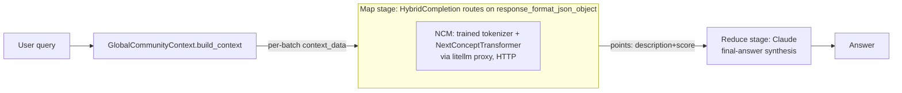
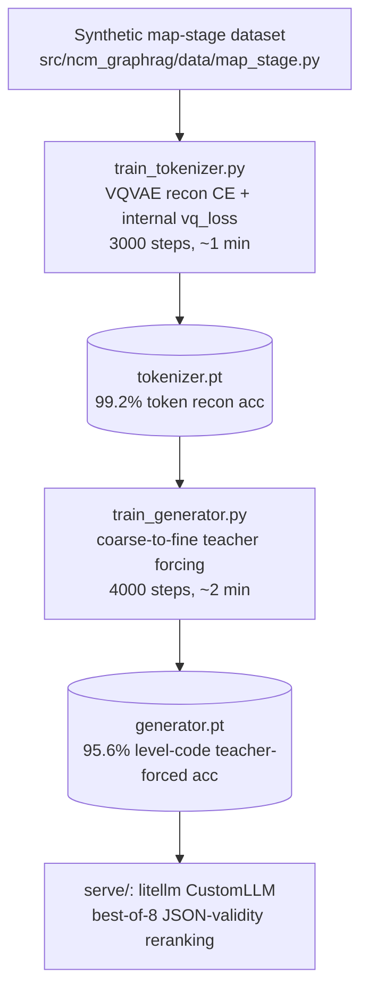

# Architecture

## Integration seam (graphrag side)

graphrag's LLM layer is `graphrag-llm` (`third_party/graphrag/packages/graphrag-llm`):
an abstract `LLMCompletion` (`completion/completion.py`) with a sync `completion()`
and async `completion_async()`, created generically through
`graphrag_llm.completion.create_completion(ModelConfig)`. The default/only built-in
implementation, `LiteLLMCompletion`, routes every call through LiteLLM
(`litellm.acompletion(model=f"{provider}/{model}", api_base=..., ...)`).

**This makes pointing graphrag at an OpenAI-compatible local server a pure config
change** — no graphrag code edits needed:

```python
ModelConfig(
    type="litellm",
    model_provider="openai",
    model="ncm-mapstage",
    api_base="http://127.0.0.1:4010/v1",
    api_key="sk-ncm-local",
)
```

Three bounded-output call sites all go through the identical
`completion_async(messages=..., response_format_json_object=...)` seam:
- `graphrag/index/operations/extract_graph/graph_extractor.py` (entity/relationship
  extraction) — free-text delimiter format, multi-round "gleaning" loop. NOT a
  single-shot bounded call; adapting NCM here needs a prompt/parsing redesign, not
  just a backend swap.
- `graphrag/query/structured_search/global_search/search.py:_map_response_single_batch`
  (Global Search map stage) — single-shot, `response_format_json_object=True`,
  `{"points":[{"description","score"}, ...]}`. **This project's slice.**
- `graphrag/index/operations/summarize_communities/community_reports_extractor.py`
  (community reports) — single-shot, typed `response_format=CommunityReportResponse`
  pydantic schema. Natural second slice (not implemented here).

## This project's slice: Global Search map stage



- **Map stage → NCM.** Bounded JSON output
  (`{"points":[{"description":...,"score":...}]}`), single report in, single point out.
- **Reduce stage → standard AR LLM (Claude via litellm).** Open-ended multi-paragraph
  synthesis across all map responses, per the task brief's own recommendation.
- `HybridCompletion` (`src/ncm_graphrag/graphrag_integration/hybrid_completion.py`)
  implements `LLMCompletion` and routes between two real `create_completion(...)`
  instances on the one signal that distinguishes the two call shapes:
  `response_format_json_object` is set for the map call, never for reduce
  (`search.py:97` + `:240` vs `:396-404`). `GlobalSearch` itself has no native
  two-model split — this wrapper is what makes the hybrid split possible without
  touching graphrag code.

## Training pipeline (fills the gap: no official NCM trainer exists)



`train_tokenizer.py`/`train_generator.py` reconstruct the training contract implied
by `models/next_concept.py`'s `generate()` method (the only place the exact input
shape is exercised correctly upstream) — see inline docstrings for the exact
`models/*.py` line references this was reverse-engineered from, and
`docs/constraints.md` for why this reconstruction was necessary at all.

## Real run results (not projected — actually executed)

### Single-sample vs best-of-N decode quality

Greedy decode (matching the released xsum/wmt14 configs' own approach — see
`docs/constraints.md` #4) produces valid `{"points":[...]}` JSON on **17/30** held-out
synthetic examples. Batching 8 stochastic samples (temperature 0.9, top_k 16) in one
forward pass and picking the first JSON-valid candidate
(`MapStageGenerator.generate_best_of_n`) raises that to **30/30**. This directly
operationalizes the task brief's own observation: a map-stage caller already pays for
many short generations per query, so the reranking budget is close to free. `serve/`
uses `generate_best_of_n` by default.

### End-to-end GlobalSearch run (`graphrag_integration/run_map_stage_demo.py`)

Ran graphrag's real `GlobalSearch` class (not a reimplementation) against 4 synthetic
`CommunityReport`/`Community` objects, query "How are regional stakeholders responding
to cybersecurity incidents?", comparing the NCM+Claude hybrid against a pure-Claude
baseline:

| | Hybrid (NCM map + Claude reduce) | Baseline (Claude map + reduce) |
|---|---|---|
| Map stage output | 1 point, garbled entity ("theotech Bi"), wrong topic (corporate mergers, not cybersecurity) | 2 points, correct topic, coherent, cited `[Data: Reports (1)]` |
| Final answer | Correctly reports "I cannot find relevant information" (map stage failed to surface the right report) | Coherent synthesis citing the actual cybersecurity report |
| Wall clock | 3.8s | 4.4s |

**This surfaces a real, previously-only-theoretical limitation**: `GlobalCommunityContext.build_context`
batched all 4 synthetic reports into a *single* context chunk (well under its
8000-token default), so graphrag made exactly **one** map call carrying all 4 reports'
text concatenated. This project's NCM model was trained on exactly one report per call
(see `docs/constraints.md` #4, "known scope cuts") — fed four reports at once, it
falls outside its trained input shape and degrades (wrong topic, garbled entity,
single point instead of per-report points). Claude, an open-vocabulary AR model with
no such training-time shape constraint, handles the multi-report batch correctly.

This is the predicted failure mode, not a surprise: it's exactly why
`docs/constraints.md` scopes this project's NCM model to single-report-per-call and
flags "N reports per call" as unimplemented. A production version needs either (a) a
larger bounded output trained to emit multiple points per call, matching graphrag's
real batch granularity, or (b) client-side fan-out — one NCM call per report,
aggregated before the reduce stage. Also had to work around a real upstream bug
encountered while running this (`GlobalSearch(json_mode=True)`, the default, passes
`response_format_json_object` twice into `completion_async`, a duplicate-kwarg
`TypeError` in this graphrag revision — worked around with `json_mode=False`,
documented in the demo script).

### Throughput note

The task brief's RTX 3090 throughput numbers (lm1b-large, 836M params) don't transfer:
this model is ~0.84M non-embedding params (generator) + 6.68M (tokenizer), several
orders of magnitude smaller, trained and run on the same GPU. Re-measure once a
production-sized model (trained on real graphrag community-report volumes/lengths) exists.
