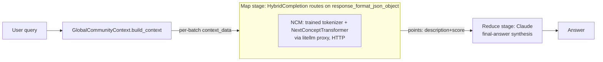
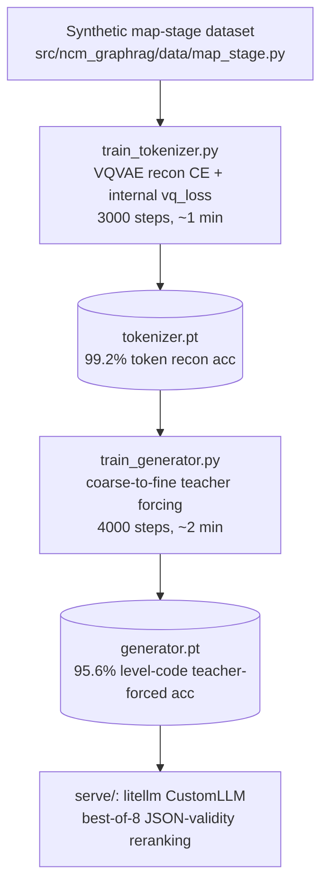
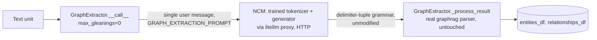
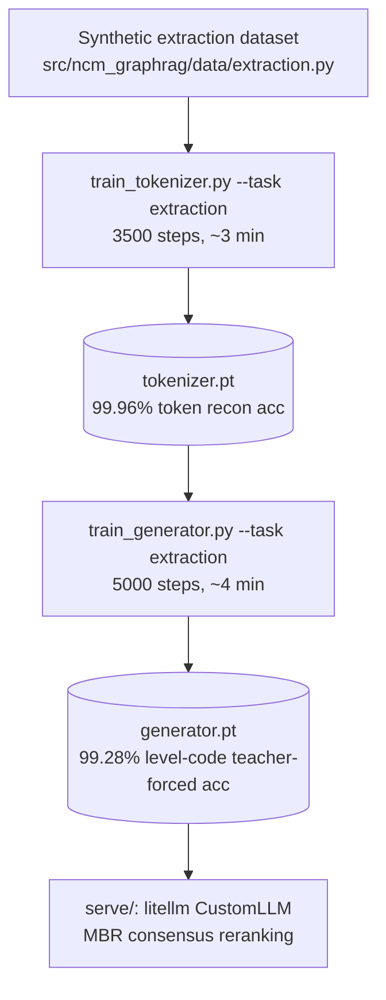

# Architecture

## Integration seam (graphrag side)

graphrag's LLM layer is `graphrag-llm` (`third_party/graphrag/packages/graphrag-llm`):
an abstract `LLMCompletion` (`completion/completion.py`) with a sync `completion()`
and async `completion_async()`, created generically through
`graphrag_llm.completion.create_completion(ModelConfig)`. The default/only built-in
implementation, `LiteLLMCompletion`, routes every call through LiteLLM
(`litellm.acompletion(model=f"{provider}/{model}", api_base=..., ...)`).

**This makes pointing graphrag at an OpenAI-compatible local server a pure config
change** — no graphrag code edits needed:

```python
ModelConfig(
    type="litellm",
    model_provider="openai",
    model="ncm-mapstage",
    api_base="http://127.0.0.1:4010/v1",
    api_key="sk-ncm-local",
)
```

Three bounded-output call sites all go through the identical
`completion_async(messages=..., response_format_json_object=...)` seam:
- `graphrag/index/operations/extract_graph/graph_extractor.py` (entity/relationship
  extraction) — free-text delimiter format, multi-round "gleaning" loop for the full
  task. **This project's second slice**, scoped to the single-shot, entity-only part
  of the call (`max_gleanings=0`, no relationship extraction) — see below.
- `graphrag/query/structured_search/global_search/search.py:_map_response_single_batch`
  (Global Search map stage) — single-shot, `response_format_json_object=True`,
  `{"points":[{"description","score"}, ...]}`. **This project's first slice.**
- `graphrag/index/operations/summarize_communities/community_reports_extractor.py`
  (community reports) — single-shot, typed `response_format=CommunityReportResponse`
  pydantic schema. Natural third slice (not implemented here).

## Slice 1: Global Search map stage



- **Map stage → NCM.** Bounded JSON output
  (`{"points":[{"description":...,"score":...}]}`), single report in, single point out.
- **Reduce stage → standard AR LLM (Claude via litellm).** Open-ended multi-paragraph
  synthesis across all map responses, per the task brief's own recommendation.
- `HybridCompletion` (`src/ncm_graphrag/graphrag_integration/hybrid_completion.py`)
  implements `LLMCompletion` and routes between two real `create_completion(...)`
  instances on the one signal that distinguishes the two call shapes:
  `response_format_json_object` is set for the map call, never for reduce
  (`search.py:97` + `:240` vs `:396-404`). `GlobalSearch` itself has no native
  two-model split — this wrapper is what makes the hybrid split possible without
  touching graphrag code.

## Slice 1 training pipeline (fills the gap: no official NCM trainer exists)

`train_generator.py` precomputes frozen VQ-VAE codes and next-level embeddings
in `<generator save_path>.cache.pt`. `NCM_GENERATOR_CACHE` overrides that path.
The cache records SHA-256 identities for the tokenizer checkpoint bytes, loaded
model state, and both complete tokenized prefix/target matrices (including dtype,
shape, row order, padding, and EOS). Model architecture, quantizer levels, and a
format version are also checked. Checkpoint weights must match the loaded model.
Stored tensor checksums detect changed payloads.

Changed checkpoints or tokenized data and legacy caches without provenance produce
an error naming the cache. Remove that file and rerun training to rebuild; never
reuse a pre-provenance cache. New files are written atomically. Cache construction
uses eval mode, batches of 64, and CPU storage; training transfers only selected
rows to the model device. Prefix embeddings remain computed online, preserving
condition dropout and contextual-prefix behavior.

The offline CPU acceptance workload (`bash autoresearch.sh`) compares cached codes
and embeddings with fresh VQ-VAE outputs and runs a generator optimizer step.
Regression coverage independently changes prefix and target token IDs, replaces a
checkpoint at the same path, and rejects legacy or altered cache payloads. These
checks do not establish training quality: the full 1,500/3,000-step probe and
held-out evaluation remain required before merging the training pipeline.




`train_tokenizer.py`/`train_generator.py` reconstruct the training contract implied
by `models/next_concept.py`'s `generate()` method (the only place the exact input
shape is exercised correctly upstream) — see inline docstrings for the exact
`models/*.py` line references this was reverse-engineered from, and
`docs/constraints.md` for why this reconstruction was necessary at all.

## Slice 1 real run results (not projected — actually executed)

### Single-sample vs best-of-N decode quality

Greedy decode (matching the released xsum/wmt14 configs' own approach — see
`docs/constraints.md` #4) produces valid `{"points":[...]}` JSON on **17/30** held-out
synthetic examples. Batching 8 stochastic samples (temperature 0.9, top_k 16) in one
forward pass and picking the first JSON-valid candidate
(`NCMTaskGenerator.generate_best_of_n`) raises that to **30/30**. This directly
operationalizes the task brief's own observation: a map-stage caller already pays for
many short generations per query, so the reranking budget is close to free. `serve/`
uses `generate_best_of_n` by default.

### End-to-end GlobalSearch run (`graphrag_integration/run_map_stage_demo.py`)

Ran graphrag's real `GlobalSearch` class (not a reimplementation) against 4 synthetic
`CommunityReport`/`Community` objects, query "How are regional stakeholders responding
to cybersecurity incidents?", comparing the NCM+Claude hybrid against a pure-Claude
baseline:

| | Hybrid (NCM map + Claude reduce) | Baseline (Claude map + reduce) |
|---|---|---|
| Map stage output | 1 point, garbled entity ("theotech Bi"), wrong topic (corporate mergers, not cybersecurity) | 2 points, correct topic, coherent, cited `[Data: Reports (1)]` |
| Final answer | Correctly reports "I cannot find relevant information" (map stage failed to surface the right report) | Coherent synthesis citing the actual cybersecurity report |
| Wall clock | 3.8s | 4.4s |

**This surfaces a real, previously-only-theoretical limitation**: `GlobalCommunityContext.build_context`
batched all 4 synthetic reports into a *single* context chunk (well under its
8000-token default), so graphrag made exactly **one** map call carrying all 4 reports'
text concatenated. This project's NCM model was trained on exactly one report per call
(see `docs/constraints.md` #4, "known scope cuts") — fed four reports at once, it
falls outside its trained input shape and degrades (wrong topic, garbled entity,
single point instead of per-report points). Claude, an open-vocabulary AR model with
no such training-time shape constraint, handles the multi-report batch correctly.

This is the predicted failure mode, not a surprise: it's exactly why
`docs/constraints.md` scopes this project's NCM model to single-report-per-call and
flags "N reports per call" as unimplemented. A production version needs either (a) a
larger bounded output trained to emit multiple points per call, matching graphrag's
real batch granularity, or (b) client-side fan-out — one NCM call per report,
aggregated before the reduce stage. Also had to work around a real upstream bug
encountered while running this (`GlobalSearch(json_mode=True)`, the default, passes
`response_format_json_object` twice into `completion_async`, a duplicate-kwarg
`TypeError` in this graphrag revision — worked around with `json_mode=False`,
documented in the demo script).

### Throughput note

The task brief's RTX 3090 throughput numbers (lm1b-large, 836M params) don't transfer:
this model is ~0.84M non-embedding params (generator) + 6.68M (tokenizer), several
orders of magnitude smaller, trained and run on the same GPU. Re-measure once a
production-sized model (trained on real graphrag community-report volumes/lengths) exists.

## Slice 2: Entity extraction (graph_extractor.py)



Entity-only (not entity+relationship — see docs/constraints.md #6 for why), served
directly as `ncm-extraction` alongside `ncm-mapstage` from the same litellm proxy
(`serve/litellm_config.yaml`, `NCMTaskLLM`). No `HybridCompletion` needed here:
`graphrag`'s real config schema lets each workflow (`extract_graph`, `global_search`,
...) reference its own `completion_model_id` independently, so extraction's
`GraphExtractor` is pointed straight at the NCM-backed model, no routing wrapper
required — unlike `GlobalSearch`, which hardcodes one model for both map and reduce.

`src/ncm_graphrag/serve/custom_handler.py`'s `_build_prefix_extraction` extracts the
"-Real Data-" (`Entity_types: ...` / `Text: ...`) section out of the full
~900-token `GRAPH_EXTRACTION_PROMPT` (goal, format rules, 3 worked examples) before
handing it to the model — verified byte-for-byte against the real prompt text
(`GRAPH_EXTRACTION_PROMPT.format(...)` round-tripped through the handler produces
exactly `ExtractionExample.prefix_text`'s training format).

## Slice 2 training pipeline



`src/ncm_graphrag/ncm/task_registry.py` is what makes this a second task instead of a
second copy of `train_tokenizer.py`/`train_generator.py`/`generate.py` — those three
files are unchanged in shape from slice 1, just parameterized by `--task`.

## Slice 2 real run results — including a real decode-recipe bug this task exposed

### First attempt: 2 entities + 1 relationship, 0/30 well-formed

The first version matched the full `("entity"...)##("relationship"...)##<|COMPLETE|>`
grammar (6 VQ levels, 284 total codes, ~140 gpt2 tokens). Trained cleanly (99.5%+
teacher-forced level accuracy by the end), but free-running generation degraded badly
past roughly the first entity — **0/30 well-formed even with best-of-32 reranking**.
Shrinking to entity-only (156 codes, ~87 tokens) alone did **not** fix it (still 0/30).

### Root cause: the inherited decode penalty actively fights this grammar's repetition

Disabling pieces one at a time isolated the cause: `generate.py`'s frequency/adjacency-
penalty decode loop (copied unmodified from `eval_shard.py`, tuned for the released
xsum/wmt14 checkpoints' low-repetition natural-language targets) actively suppresses
tokens that already appeared earlier in the *same* output — including the legitimate
repeats in this grammar (`"ORGANIZATION"`, `"operates in <domain> and was named in the
text unit."` appearing twice, once per entity record). Turning the penalty off for this
task:

| Decode setting | Greedy | Best-of-4 | Best-of-8 | Best-of-16 |
|---|---|---|---|---|
| Penalty on (xsum/wmt14 default, same as map-stage) | 0/30 | 0/30 | 0/30 | 0/30 |
| Penalty off (`build_extraction_generation_cfg`) | 26-28/30 | 30/30 | 30/30 | 30/30 |

`build_extraction_generation_cfg` now sets `frequency_penalty=0`/`adjacency_penalty=""`;
`build_generation_cfg` (map-stage) is untouched. This is a genuine, measured finding,
not a guess: a decode recipe tuned for one grammar's statistics was silently wrong for
another's, and "well-formed" rate is what revealed it.

### Structural validity vs. content correctness

"Well-formed" only means graphrag's real parser accepts the structure — it says
nothing about whether the extracted entity names/descriptions are *correct*. Upgraded
`generate_best_of_n` to real Minimum Bayes Risk selection (among well-formed
candidates, pick the one with highest total word-overlap similarity to the others,
rather than just the first valid one — the Gemini doc's own recommended technique,
implemented as a cheap word-Jaccard proxy rather than a learned scorer). Result over
10 held-out examples at best-of-16: **0/10 exact matches.** The first entity per text
unit is reliably correct; the second entity's name/description frequently has
substitution or duplication noise (`"NILE LABS"` → `"NILELELENICS"`,
`"operates in"` → `"operates operates in"`). A scale gap exists: this generator has
0.84M non-embedding parameters and 8,000 synthetic examples, while the paper's
conditional generators have 88.02M parameters for XSum and 119.96M for WMT14. The
Gemini background document's 120M/1-2B GraphRAG target is a speculative projection,
not a paper result or recipe. No data-volume ratio is reported here because examples
and full-length token positions are different units. MBR/best-of-N reranking selects
among a small model's candidates; it cannot manufacture missing capacity.

### End-to-end run through graphrag's real, unmodified `GraphExtractor`

`run_extraction_demo.py` ran 3 synthetic text units through graphrag's actual
`GraphExtractor(max_gleanings=0)` — zero custom parsing code, graphrag's own
`_process_result` regex/delimiter parser consumed NCM's output directly:

| | NCM extraction | Claude extraction (baseline) |
|---|---|---|
| Entities per text unit | 2/2 (correct cardinality, all 3 units) | 2/2 |
| First entity | Correct all 3/3 (`ATLAS CORP`, `HARBOR SYSTEMS`, `STRATUS ENERGY`) | Correct 3/3, richer descriptions |
| Second entity | Name/description noise all 3/3 (`NILELELENICS`, `CRESTLINE LLCERS`, `ORARB DYNAMICS`) | Correct 3/3 |
| Relationships | None (entity-only model, by design) | 1 per unit, correctly described |
| Wall clock, 3 text units | **0.4s** | 4.3s |

~10x faster, correct cardinality, correct first entity every time, measurably
imperfect second-entity content, and no relationships by design. A faithful, bounded
picture of what a from-scratch NCM pair at this parameter/data scale actually delivers
against graphrag's real extraction call — not a cherry-picked success or a hidden
failure.
